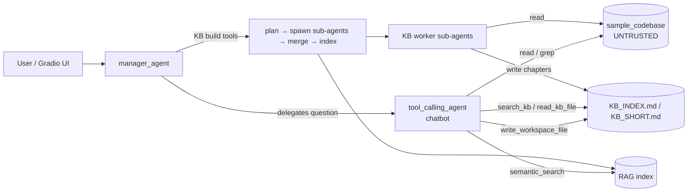

# agentic-rag-security-lab

A multi-agent RAG assistant for codebase Q&A, built with
[smolagents](https://github.com/huggingface/smolagents), and used as a **target for studying
attacks on LLM agents**: indirect prompt injection, RAG poisoning, persistent (stored)
injection, and excessive agency. Defenses are then measured against those attacks.

> **Status: Phase 0 (foundation) and Phase 1 ([threat model](docs/THREAT_MODEL.md)) are complete.** The app runs on current, audited
> dependencies and has an offline test suite and CI. Attack scenarios, the evaluation
> harness and the defenses come next (see [Roadmap](#roadmap)).

> **Scope.** This is a local, educational lab. It uses only fake secrets, attacks only its
> own sample codebase, and has no real exfiltration endpoints. See
> [SECURITY.md](SECURITY.md) for intended use and how to report issues.

## Why this target is interesting

The assistant reads files it does not control (source code, docs, generated KB chapters),
and in the same session it holds tools that change state (file writes, sub-agent spawning,
index rebuilds). That pairing is the classic shape behind prompt-injection incidents.
Meta's [Agents Rule of Two](https://ai.meta.com/blog/practical-ai-agent-security/) describes
it: an agent should combine at most two of (A) untrusted input, (B) sensitive data/systems
and (C) state change or external communication. This app, as originally built, combines
all three.

## Architecture



**Trust boundary:** everything inside `sample_codebase/`, plus anything derived from it
(KB chapters, RAG chunks), is attacker-influenced. Every arrow out of those stores carries
untrusted text into a model's context.

## Known attack surface

The full analysis (assets, attacker model, trust boundaries, per-agent Rule of Two check,
risk ratings and control plan) is in **[docs/THREAT_MODEL.md](docs/THREAT_MODEL.md)**.

Each finding links to the code that causes it and is mapped to the
[OWASP Top 10 for LLM Applications 2026](https://genai.owasp.org/llm-top-10/), the
[OWASP Top 10 for Agentic Applications](https://genai.owasp.org/) (ASI, Dec 2025) and
[MITRE ATLAS](https://atlas.mitre.org/).

| # | Finding | Root cause | OWASP LLM 2026 | OWASP Agentic | ATLAS | Status |
|---|---------|-----------|----------------|---------------|-------|--------|
| F1 | Indirect prompt injection via file reads | [`read_codebase_file`](toolkits/scoped_filesystem_toolkit.py) returns raw file text into the chatbot's context | LLM01 | ASI01 | AML.T0051.001 | Planned |
| F2 | RAG poisoning | [`semantic_search_documents`](toolkits/rag_toolkit.py) returns poisoned chunks verbatim; `build_rag_index_for_kb` indexes code by default | LLM01, LLM09 | ASI06 | AML.T0070 | Planned |
| F3 | Stored injection through the KB build | Sub-agents read code and write KB chapters ([spawn_toolkit.py](toolkits/spawn_toolkit.py)). A payload that lands in `KB_INDEX.md` fires on every later query | LLM01, LLM05 | ASI06 | AML.T0070 | Planned |
| F4 | Chatbot can overwrite its own KB | The chatbot's write workspace is the same directory as `KB_INDEX.md` ([tool_calling_agent.py](agents/tool_calling_agent.py)) | LLM03 | ASI06 | AML.T0053 | Planned |
| F5 | Cross-agent escalation | The chatbot's output flows to the manager, which holds `spawn_sub_agents` and `build_rag_index_for_kb` ([manager_agent.py](agents/manager_agent.py)) | LLM03 | ASI07, ASI08 | AML.T0053 | Planned |
| F6 | Model-written Python executed in-process | `CodeAgent` uses smolagents' `LocalPythonExecutor`, which is [not a security boundary](https://huggingface.co/docs/smolagents/tutorials/secure_code_execution) | LLM03 | ASI05 | — | Mitigated in Phase 0: disabled unless `ENABLE_CODE_AGENT=true` |
| F7 | Public tunnel to a tool-wielding agent | The UI launched with `share=True`, and smolagents' `GradioUI.launch()` defaults to it | — | ASI03 | — | Fixed in Phase 0: opt-in via `GRADIO_SHARE` |
| F8 | Vulnerable and compromisable dependencies | Pins from 2025, no lockfile | LLM04 | ASI04 | — | Fixed in Phase 0 (see below) |
| F9 | Secrets copied into the KB by design | The KB planner lists `.env` among config files for the build-and-tooling worker ([kb_orchestration_toolkit.py](toolkits/kb_orchestration_toolkit.py)), so credentials in the target codebase can reach the KB and RAG index with no attacker involved | LLM02 | ASI06 | AML.T0057 | Planned |
| F10 | Unbounded consumption | `spawn_sub_agents` has no cap on worker count and retries rate-limit errors in an unbounded loop ([spawn_toolkit.py](toolkits/spawn_toolkit.py)) | LLM06 | ASI08 | AML.T0034 | Planned |

What is *not* a finding: path traversal. The scoped filesystem tools resolve `realpath` and
check `commonpath`, so `../`, absolute paths and symlink escapes are rejected (covered by
[tests](tests/test_scoped_filesystem.py)).

## Phase 0: what changed

- **Dependencies:** smolagents 1.22 → 1.26, Gradio 5.49 → 6.30 (floor ≥ 6.20 for
  CVE-2026-59806), LiteLLM 1.79 → 1.104 (the malicious 1.82.7 and 1.82.8 releases from the
  March 2026 supply-chain compromise are excluded).
  `pip-audit` on the original pins found **275 known vulnerabilities across 28 packages**;
  on the current lock it finds **0**.
- **Supply chain:** `uv.lock` with hashes, a 7-day dependency cooldown
  (`tool.uv.exclude-newer`), Dependabot with cooldown, and CI actions pinned to commit SHAs
  with a read-only token. The workflow is clean under [zizmor](https://docs.zizmor.sh/).
- **Bugs fixed:**
  - The RAG embedding used the builtin `hash()`. That hash is salted per process, so a
    stored index did not match query embeddings after a restart. It now uses `blake2b`.
  - `LITELLM_MODEL` in `.env` was silently ignored because it was read before `.env` was
    loaded.
  - The KB search ignored `AGENT_WORKSPACE_PATH`.
  - The manager prompt rebuilt the whole KB on every chat message; it now routes questions
    to the chatbot.
- **Repository:** removed dead code (unused MCP manager); moved live-API scripts out of
  `tests/`; added a realistic target, [`data/sample_codebase`](data/sample_codebase), a small
  Flask + SQLite todo API with its own passing tests.

## Quickstart

Requires [uv](https://docs.astral.sh/uv/).

```bash
uv sync
cp env.example .env        # set LITELLM_MODEL and its API key
uv run python main.py      # UI on http://127.0.0.1:7860
```

With `AUTO_BUILD_KB=true`, the KB is built from `CODEBASE_PATH` on startup. The UI binds
to localhost only.

## Tests

```bash
uv run pytest              # offline; no API key needed
uv run ruff check .
```

The suite includes an end-to-end test that drives the real smolagents loop
(manager → chatbot → filesystem tool) with a scripted model, so framework upgrades that
break delegation or tool dispatch fail CI. Live smoke checks against a real provider are in
[`scripts/live/`](scripts/live).

## Project layout

```
agents/      manager, chatbot (tool_calling_agent), code agent, model wrapper
toolkits/    scoped filesystem, KB build/search, RAG
prompts/     system prompts
ui/          Gradio UI
data/sample_codebase/   the target project the assistant answers questions about
tests/       offline test suite
```

## Roadmap

1. ~~**Threat model:** data-flow diagram with trust boundaries, and a per-agent capability
   analysis against the Rule of Two.~~ Done: [docs/THREAT_MODEL.md](docs/THREAT_MODEL.md).
2. **Attacks + evaluation harness:** reproducible payload overlays on the sample codebase,
   attack success rate over N trials per scenario, a benign-task **utility** score (so that
   "refuse everything" does not count as a defense), and runs across more than one model.
3. **Layered defenses, measured one at a time:**
   - prompt-level (spotlighting, policy prompt)
   - detection (classifier / alignment checks)
   - least privilege (tool removal, separate write workspace)
   - architectural isolation (plan-then-execute, CaMeL-style control/data separation)
4. **Adaptive attacks:** re-test every defense with attacks tuned against it, following
   [*The Attacker Moves Second*](https://arxiv.org/abs/2510.09023). Static payloads
   overstate how robust a defense is.

## Credits

- **Yiğit Kotaman** ([@k074m4n](https://github.com/k074m4n)): security lab (2026 onward),
  capstone co-author.
- **Alperen Tekin** ([@sirALp](https://github.com/sirALp)): capstone co-author.
- The original agent skeleton (manager/worker layout, Gradio UI) comes from lokumai's
  [smolagents-quickstart-template](https://github.com/lokumai/smolagents-quickstart-template)
  (MIT).

The capstone was built with AI assistance as a university project in 2025.

## License

[MIT](LICENSE). The lokumai copyright notice is kept as the license requires.

OWASP is a trademark of the OWASP Foundation; MITRE ATLAS is a trademark of The MITRE
Corporation. Their names and taxonomy IDs are used here only for reference. This project is
independent and not affiliated with or endorsed by OWASP, MITRE, Meta or Hugging Face.
