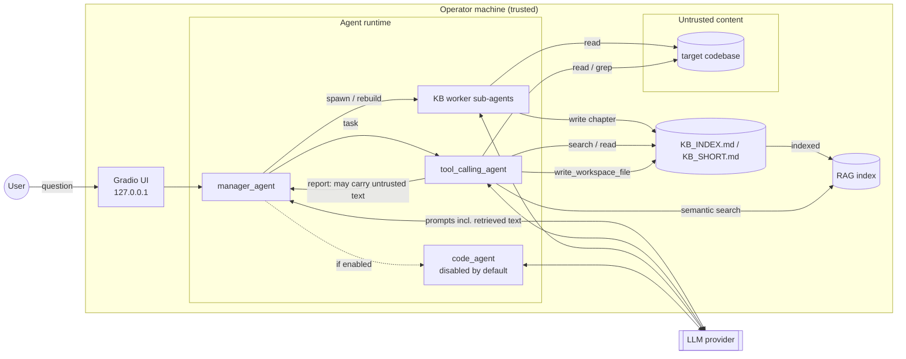

# Threat model

| | |
|---|---|
| **System** | agentic-rag-security-lab: multi-agent codebase Q&A assistant (smolagents) |
| **Version modelled** | `main` after Phase 0 |
| **Method** | Data-flow diagram + trust boundaries, per-agent capability analysis against Meta's [Agents Rule of Two](https://ai.meta.com/blog/practical-ai-agent-security/), threats organised by the layers of CSA's [MAESTRO](https://cloudsecurityalliance.org/blog/2025/02/06/agentic-ai-threat-modeling-framework-maestro) |
| **Taxonomies** | OWASP Top 10 for LLM Applications 2026 (LLMxx), OWASP Top 10 for Agentic Applications (ASIxx), MITRE ATLAS (AML.Txxxx) |
| **Status** | Living document; each threat links to the scenario that will measure it (Phase 2) and the controls planned for it (Phase 3) |

## 1. Scope and assumptions

**In scope:** the agents (`manager_agent`, `tool_calling_agent`, KB worker sub-agents,
optional `code_agent`), their tools, the KB build pipeline, the RAG index, and the Gradio UI.

**Assumptions**

- The **operator** (whoever runs the app) is trusted and runs it locally on their own machine.
- The **LLM provider** is trusted to execute requests faithfully. Its compromise is out of
  scope, but note that every file the agents read is sent to the provider.
- The **host OS and Python runtime** are trusted. The `code_agent` is the exception and is
  treated separately (T6).
- The assistant answers questions about a codebase it **did not write and does not
  control**. This is the defining property of the system and the root of most threats below.

## 2. Attacker model

| Attacker | Capability | Realistic example |
|---|---|---|
| **Content attacker** (primary) | Can place text in files the assistant will read: source, comments, docs, configs. Cannot reach the UI, the host or the provider. | A malicious pull request, a compromised dependency's docs, or a third-party repository the operator asks questions about |
| **Network attacker** (secondary) | Can reach the UI if it is exposed beyond localhost | Anyone holding a public share link (T7) |
| **Supply-chain attacker** | Can publish a malicious version of a Python dependency | The LiteLLM compromise of March 2026 (T8) |

The content attacker needs no credentials and no access to the operator, which makes it the
cheapest attacker and the focus of this lab.

## 3. Assets

| ID | Asset | Why it matters |
|---|---|---|
| A1 | **Integrity of answers** | Users act on what the assistant tells them about the code |
| A2 | **Integrity of the KB and RAG index** | Persistent. A corrupted entry affects every later question, for every user |
| A3 | **Secrets**: the operator's provider API keys in the process environment; credentials that exist inside the analysed codebase | Disclosure means direct financial and security loss |
| A4 | **Operator host**: files outside the sandboxed roots, code execution | Compromise escapes the lab entirely |
| A5 | **Budget and availability**: LLM tokens, rate limits | Every agent step costs money |
| A6 | **Accountability**: being able to reconstruct what an agent did and why | Without it, incidents cannot be detected or investigated |

## 4. System model

### Trust boundaries

| ID | Boundary | What crosses it |
|---|---|---|
| TB-1 | Untrusted content → agent context | File text, grep lines, KB chapters and RAG chunks enter model prompts **with the same standing as instructions**. Nothing currently marks them as data. |
| TB-2 | Agent ↔ agent | The chatbot's report, which can quote untrusted text, becomes input to the manager, which holds more powerful tools. |
| TB-3 | Agent → persistent stores | Agents write KB chapters, and the chatbot can write into the KB directory. Whatever is written there crosses TB-1 again on every later query. |
| TB-4 | Runtime → LLM provider | All context, including codebase contents, leaves the machine. |
| TB-5 | User ↔ UI | Local only by default (`GRADIO_SHARE=false`). |

TB-3 is what turns a one-off injection into a **persistent** one: a store written by an
agent is read back as trusted context.

## 5. Capability analysis (Rule of Two)

The Rule of Two says an agent should combine **at most two** of:
**[A]** processing untrusted input, **[B]** access to sensitive data or systems,
**[C]** changing state or communicating externally.

| Agent | [A] Untrusted input | [B] Sensitive data/systems | [C] State change / external | Verdict |
|---|---|---|---|---|
| KB worker sub-agent | ✅ reads the whole target codebase | ✅ every file in it, including any secrets (see T9) | ✅ writes KB chapters that become persistent context | ❌ **all three** |
| `tool_calling_agent` (chatbot) | ✅ codebase, KB, RAG | ✅ same as above | ✅ `write_workspace_file` into the KB directory | ❌ **all three** |
| `manager_agent` | ✅ indirectly, through the chatbot's report | — | ✅ spawns sub-agents, rebuilds the index | ⚠️ A + C |
| `code_agent` (if enabled) | ✅ indirectly, through the manager | ✅ host process | ✅ executes code | ❌ **all three** |

Two agents break the rule in the default configuration, and both do so through a capability
the task does not need: a **question-answering** chatbot has no reason to write files. This
is the clearest least-privilege fix (Phase 3, D3).

## 6. Threats

Likelihood assumes the content attacker from §2. **H** = high, **M** = medium, **L** = low.

| ID | Threat | Flow | Assets | Taxonomy | L | I | Risk | Current state |
|---|---|---|---|---|---|---|---|---|
| T1 | **Goal hijack through file content**: instructions embedded in a source file redirect the chatbot's answer | TB-1 via `read_codebase_file`, `grep_codebase` | A1 | LLM01 · ASI01 · AML.T0051.001 | H | M | **High** | Open (F1) |
| T2 | **Retrieval poisoning**: content written to rank highly for likely questions is served by semantic search | TB-1 via `semantic_search_documents`, `search_kb` | A1, A2 | LLM01, LLM09 · ASI06 · AML.T0070 | H | M | **High** | Open (F2) |
| T3 | **Persistent KB poisoning**: a worker copies or follows embedded instructions while writing a chapter; the result is merged into `KB_INDEX.md` and indexed | TB-1 → TB-3 | A2, A1 | LLM01, LLM05 · ASI06 · AML.T0070 | H | H | **Critical** | Open (F3) |
| T4 | **Self-poisoning**: the chatbot is steered into overwriting KB files, because its write root *is* the KB directory | TB-1 → TB-3 | A2 | LLM03 · ASI06 · AML.T0053 | M | H | **High** | Open (F4) |
| T5 | **Cross-agent escalation**: untrusted text in the chatbot's report steers the manager into using its privileged tools | TB-1 → TB-2 | A2, A5 | LLM03 · ASI07, ASI08 · AML.T0053 | M | H | **High** | Open (F5) |
| T6 | **Model-written code execution** in the host process | TB-2 → host | A4, A3 | LLM03 · ASI05 | M | H | High → **Low** | Mitigated: off unless `ENABLE_CODE_AGENT=true` (F6) |
| T7 | **Public exposure** of a tool-wielding agent | TB-5 | A4, A5 | ASI03 | M | H | High → **Low** | Fixed in Phase 0 (F7) |
| T8 | **Compromised or vulnerable dependency** | Build | A3, A4 | LLM04 · ASI04 | M | H | High → **Low** | Fixed in Phase 0 (F8) |
| T9 | **Secrets copied into the KB by design**: the KB planner lists `.env` among the config files and points the build-and-tooling worker at them, so credentials in the target codebase can be written into the KB and the RAG index and served to any user, with **no attacker involved** | TB-1 → TB-3 | A3 | LLM02 · ASI06 · AML.T0057 | M | H | **High** | Open (F9) |
| T10 | **Unbounded consumption**: `spawn_sub_agents` has no upper bound on the number of workers and retries rate-limit errors in an unbounded loop. Combined with T5, a single question can drive a large number of model calls | TB-2 | A5 | LLM06 · ASI08 · AML.T0034 | M | M | **Medium** | Open (F10) |
| T11 | **Unfiltered output to the user**: model output is rendered in the UI without validation, so a hijacked answer reaches the user unchanged | Agent → UI | A1 | LLM10 | M | M | **Medium** | Open |
| T12 | **No audit trail**: tool calls and agent hand-offs are not traced, so an injection cannot be detected or reconstructed after the fact | All | A6 | MAESTRO L5 (observability) | H | M | **High** | Open |
| T13 | **Path traversal** out of the codebase or workspace roots | Filesystem tools | A4 | — | L | H | **Low** | Mitigated: `realpath` + `commonpath` checks, covered by tests |

**Highest priority:** T3 and T9. Both corrupt a persistent store that every later session
trusts, and T9 needs no attacker at all.

## 7. Control plan

Controls are grouped into layers and will be **added and measured one at a time**, so
that each one's effect on attack success and on utility is visible on its own.

| Layer | Control | Threats addressed | Notes |
|---|---|---|---|
| **D1 Prompt-level** | Mark retrieved content as data (spotlighting / delimiting) plus a policy in the system prompt | T1, T2, T3 | Cheap; known to be bypassable by adaptive attacks. Measured as a baseline, not relied on. |
| **D2 Detection** | Injection classifier on tool outputs; trace-level alignment check of the agent's actions against the user's request | T1–T5 | Must report false positives on benign content, not only blocked attacks |
| **D3 Least privilege** | Remove `write_workspace_file` from the chatbot; give workers a write root separate from the KB; cap `number_of_subagents` and retries; exclude secret files from the KB pipeline | T4, T5, T9, T10 | Removes capabilities instead of asking the model to behave. Expected to be the most robust layer. |
| **D4 Architecture** | Separate planning from untrusted data (plan-then-execute; CaMeL-style control/data separation) so that retrieved text cannot change which tools are called | T1–T5 | Highest cost, strongest guarantee |
| **D5 Output & audit** | Validate output before display; OpenTelemetry tracing of every tool call and hand-off | T11, T12 | Tracing also supplies the evidence for Phase 2 measurements |

## 8. How this will be measured (Phase 2)

- **Scenarios:** one or more per open threat, implemented as payload overlays on a copy of
  the clean sample codebase, so the tracked target stays clean.
- **Attack success rate (ASR)** over N trials per scenario. A single run proves nothing
  about a stochastic system.
- **Utility:** the share of benign questions answered correctly under the same
  configuration, so that a defense which refuses everything scores badly.
- **Detection quality** for D2: true- and false-positive rates on benign and attack content.
- **More than one model**, since susceptibility differs widely between models.
- **Adaptive re-test** of each defense with attacks tuned against it
  ([Nasr et al., 2025](https://arxiv.org/abs/2510.09023)). Static payloads overstate
  robustness.

## 9. Out of scope and residual risk

- **Provider-side data handling:** codebase contents are sent to the LLM provider (TB-4).
  Use a local model if the target code is confidential.
- **Model-level jailbreaks** unrelated to tool use: the lab studies *agentic* failure modes.
- **Denial of service on the host** beyond LLM consumption.
- Even with all controls, prompt injection is not solved in general. The aim is to make the
  **impact** of a successful injection small (Rule of Two) and **measurable**, not to
  claim immunity.

## References

- Meta, [Agents Rule of Two: A Practical Approach to AI Agent Security](https://ai.meta.com/blog/practical-ai-agent-security/) (2025)
- CSA, [MAESTRO: Agentic AI Threat Modeling Framework](https://cloudsecurityalliance.org/blog/2025/02/06/agentic-ai-threat-modeling-framework-maestro) (2025)
- OWASP, [Multi-Agentic System Threat Modeling Guide v1.0](https://genai.owasp.org/resource/multi-agentic-system-threat-modeling-guide-v1-0/)
- OWASP, [Top 10 for LLM Applications](https://genai.owasp.org/llm-top-10/) (2026 edition)
- MITRE, [ATLAS](https://atlas.mitre.org/)
- Nasr et al., [The Attacker Moves Second](https://arxiv.org/abs/2510.09023) (2025)
